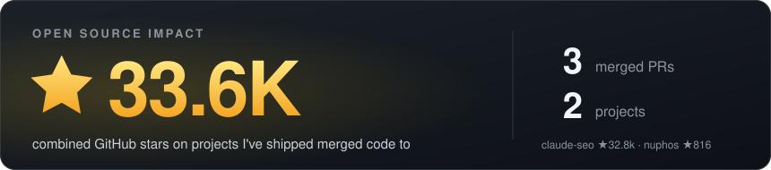

# Vivek Chaudhari

I build LLM post-training systems from scratch and ship AI products.

## About

I'm an MS Computer Science student at Northeastern University (Khoury College) in Boston, graduating in 2028. I'm a Forward Deployed Engineer on the founding team at [Context AI](https://thecontextlabs.com), and I founded Quantum AI Solutions, an applied-AI studio that builds LLM systems, agents and voice AI for businesses. Before Northeastern I did a B.Tech in ICT at DA-IICT.

Looking for Summer 2027 internships in ML / LLM engineering (Bay Area or remote).

## Featured work

<!-- FEATURED:START -->
- **[GRPO-Zero](https://github.com/Vivek-Chaudhari30/GRPO-Zero)** — From-scratch GRPO (RLVR) post-training of Qwen2.5 on GSM8K: hand-written rollout, group-relative advantages, clipped objective, KL to a LoRA-disabled reference, 53 unit tests. Results: TODO (baseline → trained pass@1). Python · updated Nov 2026
- **[Majoor](https://github.com/Vivek-Chaudhari30/my_majoor)** — Voice-first macOS menu-bar assistant, written in Swift. Swift · ★ 1 · updated Jun 2026
- **[PagedServe](https://github.com/Vivek-Chaudhari30/Paged_Serve)** — From-scratch LLM inference server: paged KV cache, continuous batching, prefix caching, a custom CUDA paged-attention kernel and an OpenAI-compatible API. Python · updated Nov 2026
<!-- FEATURED:END -->

## Open source

<!-- OPEN-SOURCE:START -->

| Project | Contribution | Status |
|---|---|---|
| [**AgriciDaniel/claude-seo**](https://github.com/AgriciDaniel/claude-seo)  | [fix(audit): compute the SEO Health Score in a script](https://github.com/AgriciDaniel/claude-seo/pull/526) |  Nov 23, 2026 |
| [**AgriciDaniel/claude-seo**](https://github.com/AgriciDaniel/claude-seo)  | [fix(images): report exact and near-duplicate images](https://github.com/AgriciDaniel/claude-seo/pull/525) |  Nov 23, 2026 |
| [**huggingface/lerobot**](https://github.com/huggingface/lerobot)  | [fix(rl): store uint8 video frames as float in [0, 1] in the offline replay buff…](https://github.com/huggingface/lerobot/pull/5413) |  Nov 18, 2026 |
| [**AgriciDaniel/claude-seo**](https://github.com/AgriciDaniel/claude-seo)  | [fix: PDF reports on macOS, clearer errors, canonical loop detection](https://github.com/AgriciDaniel/claude-seo/pull/457) |  Nov 15, 2026 |
| [**nuphos/nuphos**](https://github.com/nuphos/nuphos)  | [fix(ios): answer a refused Stop with an alert](https://github.com/nuphos/nuphos/pull/2029) |  Nov 11, 2026 |
| [**nuphos/nuphos**](https://github.com/nuphos/nuphos)  | [fix(ios): reach the newest row on the first Scroll to latest tap](https://github.com/nuphos/nuphos/pull/1808) |  Nov 7, 2026 |

[All my pull requests to other projects →](https://github.com/search?type=pullrequests&q=author%3AVivek-Chaudhari30+is%3Apr+is%3Apublic+-user%3AVivek-Chaudhari30)
<!-- OPEN-SOURCE:END -->

## Focus

LLM post-training & RL · AI agents · Voice AI

**Stack:** Python, TypeScript, JavaScript, Swift, C++, CUDA, Java, PyTorch, LangGraph, LangChain, FastAPI, Django, Node.js, Express, Next.js, React, Angular, PostgreSQL, MongoDB, AWS, Azure, GCP, Docker, GitHub Actions

## Contact

[LinkedIn](https://www.linkedin.com/in/vivek-kirankumar-chaudhari/) · [X](https://x.com/Chaudhar1Vivek) · [vivek.cs.study@gmail.com](mailto:vivek.cs.study@gmail.com)
